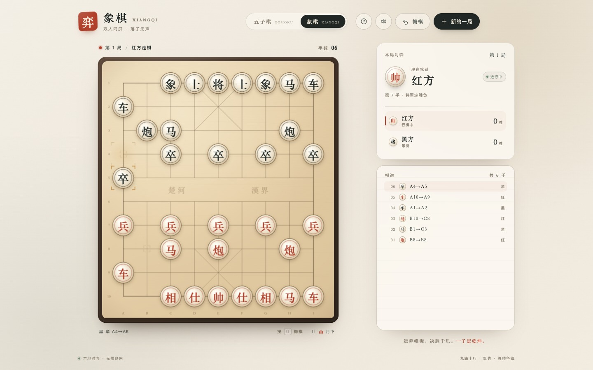

# 弈 · 棋室

双人同屏的 **五子棋 + 中国象棋**。纯静态页面，无框架、无构建、无需联网；纸墨、木质棋盘与宋体字风格。

在线试玩：<https://6bhyw4vv4d-alt.github.io/chess-room/>



## 玩法

- 顶部切换 **五子棋 / 象棋**，两套棋局各自保留棋盘、回合、比分、棋谱和悔棋状态。
- **五子棋**：15×15，黑棋先行，横、竖、斜五连即胜，长连同样算胜；满盘为和棋。
- **象棋**：红方先行，已实现九宫、蹩马腿、塞象眼、炮架吃子、兵卒过河、将帅照面、应将、绝杀与困毙。
- 点选棋子后会显示合法落点；将军时侧栏、棋盘与将帅棋子会同步提示。
- 支持悔棋、再来一局、跨局累计比分。键盘 `U` 悔棋，`M` 开关背景音乐。
- 手机端自动适配，支持触屏落子。

## 本地运行

直接双击 `index.html` 即可。也可以起一个静态服务：

```bash
python3 -m http.server 8080
# http://127.0.0.1:8080
```

部署到 GitHub Pages 后无需任何服务器。

## 背景音乐

内置的是一首原创古风氛围曲《月下》，随页面本地循环播放，不请求网络。浏览器限制自动播放，首次点击棋盘或按钮后开始。

本仓库**不包含**胡彦斌《月光》的录音。若你合法取得了音频，可放到：

```text
music/moonlight.mp3
# 或 music/moonlight.m4a
```

页面会优先加载它，并把音乐标签显示为「月光」；不需要改代码。请不要上传无权使用的版权录音。

## 文件结构

```text
index.html                     # 页面、样式、五子棋与象棋逻辑
music/moonlit-original.mp3     # 原创背景音乐
preview.jpg                    # 预览图
```

## 兼容性

面向现代浏览器（Chrome、Safari、Edge、Firefox）。使用 Canvas、`<dialog>`、Web Audio 与 CSS `svh` 等特性。
